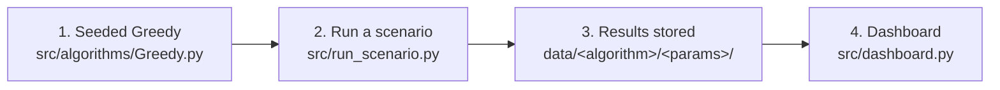

# Workflow: From Simulation to Dashboard

This guide explains how the three study scenarios get from simulation to dashboard, and which changes made that possible. Run every command from the repository root with the virtual environment activated.

| Scenario | p1 | p2 | Command |
|---|---:|---:|---|
| A (Baseline) | 0.8 | 0.9 | `python src/run_scenario.py 0.8 0.9` |
| B (Low-Variance Micro-Gap) | 0.895 | 0.9 | `python src/run_scenario.py 0.895 0.9` |
| C (High-Variance Micro-Gap) | 0.89 | 0.895 | `python src/run_scenario.py 0.89 0.895` |

## Overview



## Step 1: Greedy uses the seeded random generator

**File:** `src/algorithms/Greedy.py`

Every algorithm gets a random generator seeded with `global_seed = 42` from `config.py`, so a run can be repeated exactly. ε-Greedy drew its rewards from that generator, but it made the explore/exploit decision and picked the random arm with the global, unseeded `np.random`. As a result, the Greedy results changed on every run and could not be reproduced.

```python
# before
if np.random.rand() < epsilon:
    arm = np.random.choice(num_arms)

# after
if rng.random() < epsilon:
    arm = rng.integers(num_arms)
```

All other algorithms already used only the seeded generator. A fresh run of Scenario A reproduced their stored results exactly. The Greedy results in `data/` were regenerated with this fix.

## Step 2: Run a scenario and store the results

**File:** `src/run_scenario.py` (new)

`src/simulation.py` runs every arm combination in `config.py` (2 and 3 arms, all permutations) and skips any combination that already has results. That makes it slow, and it cannot refresh existing results. `run_scenario.py` runs exactly one two-armed scenario and always overwrites its results:

```bash
python src/run_scenario.py <p1> <p2>
```

For that scenario, it:

1. Runs all 16 algorithm configurations from `config.py` in parallel on 75% of the CPU cores.
2. Simulates each configuration with seed 42, 100 independent trials, and the time horizons from `config.py` (up to T = 1,000,000).
3. Writes the results into `data/`, using the same folders and file names as `simulation.py`:

```
data/<algorithm>/<params>/results_<p1>_<p2>.csv           # one row per timestep and trial
data/<algorithm>/<params>/average_results_<p1>_<p2>.csv   # averages over the 100 trials
```

For example, Scenario B for ε-Greedy with ε = 0.005 writes `data/Greedy/epsilon_0_005/results_895_900.csv`.

One scenario takes about 15–20 minutes on a 12-core machine. Run the scenarios one after another, because running them in parallel only splits the same cores. If you want to undo a run, restore the committed results with `git checkout -- data/`.

## Step 3: The dashboard shows only the three scenarios

**File:** `src/dashboard.py`

The dashboard used to have six plots and dropdowns for any arm combination. It now shows only Scenarios A, B and C, each with:

- three line charts over time for all 16 configurations: **Average Regret**, **Reward Variance** and **Subopt. Ratio**
- a table of the three metrics at T = 1,000,000, sorted by regret (click a column header to re-sort)

The metrics are calculated from the files in `data/`, the same way as in `src/experiments-SKILL.ipynb`:

| Metric | Calculation | Source file |
|---|---|---|
| Average Regret | mean of `Total Regret` over the 100 trials | `results_*.csv` |
| Reward Variance | sample variance of `Total Reward` over the 100 trials | `results_*.csv` |
| Subopt. Ratio | `Average Suboptimal Arms` / timestep | `average_results_*.csv` |

See [dashboard_change_report.md](dashboard_change_report.md) for the full list of code changes.

## Step 4: Show the data

```bash
python src/dashboard.py
```

Open http://127.0.0.1:8050 in your browser.

The dashboard reads `data/` only when it starts. After you run `run_scenario.py`, stop the dashboard (Ctrl + C) and start it again to see the new results.

If the dashboard fails with `Address already in use`, another dashboard is still running on port 8050. Stop it first. On macOS or Linux you can find it with `lsof -i :8050`.

## Quick Start

```bash
# optional: regenerate the results (about 15–20 minutes each)
python src/run_scenario.py 0.8 0.9
python src/run_scenario.py 0.895 0.9
python src/run_scenario.py 0.89 0.895

# show the results
python src/dashboard.py
```
